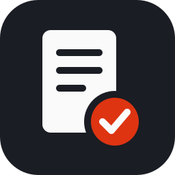
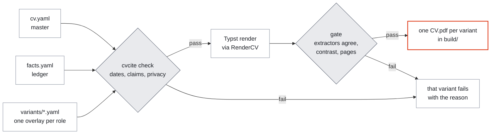
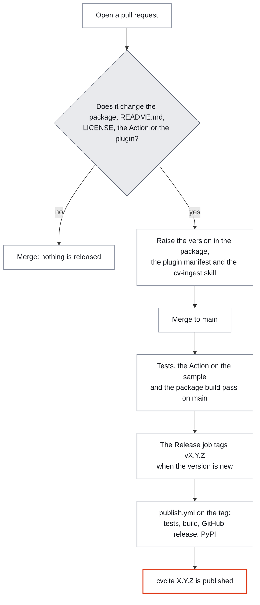

<div align="center">



# cvcite

### One master CV. A tailored PDF per role. Every claim traced to a fact.

**Build your CV from one master YAML file, tailor it for each kind of role with a small overlay, and
gate every PDF the way applicant tracking systems (ATS) read it.** Every number on the CV has to
appear in a fact of your ledger, or the build fails.

<br>

[](https://pypi.org/project/cvcite/)
[](https://www.python.org/downloads/)
[](#in-github-actions)
[](#-with-claude-code)
<br>
[](https://github.com/agusgonzaleznic/cvcite/actions/workflows/ci.yml)
[](https://github.com/agusgonzaleznic/cvcite/blob/main/LICENSE)

<br>

**[What it is](#-what-it-is) · [Quick start](#-quick-start) · [Claude Code](#-with-claude-code) · [GitHub Actions](#in-github-actions) · [Checks](#-what-gets-checked) · [Commands](#commands) · [Rendering](#how-it-renders) · [Limits](#-what-it-does-not-do) · [Release](#-how-a-release-happens) · [Development](#development) · [Support](#-support-this-project)**

</div>

---

## 🧭 What it is

It comes in three parts that work together or alone:

| Part | What it is | Where it lives |
|---|---|---|
| **Command line** | `cvcite` checks, renders and gates your CV. No AI involved. | [PyPI](https://pypi.org/project/cvcite/) |
| **Claude Code plugin** | Skills that interview you, one multiple-choice question at a time. They turn an old CV or a LinkedIn export into a fact ledger, check every date and claim, tailor the CV for a job posting, and compare LinkedIn, your website and GitHub against it. | [`plugin/`](https://github.com/agusgonzaleznic/cvcite/tree/main/plugin), listed in [`.claude-plugin/marketplace.json`](https://github.com/agusgonzaleznic/cvcite/blob/main/.claude-plugin/marketplace.json) |
| **GitHub Action** | Builds and gates the CV on every change, publishes the PDFs as a private release when you ask, and can run a claim review on pull requests with your own key. | [`action.yml`](https://github.com/agusgonzaleznic/cvcite/blob/main/action.yml) |

Your CV lives in your own private repository. This one holds the tool and a made-up sample person.

### Why

| Problem | What cvcite does |
|---|---|
| **Two CVs drift apart.** | You keep one master with every fact. Each variant is an overlay that only changes emphasis: headline, summary, bolded words, skills line, which bullets to drop. |
| **CVs overclaim.** | Every number on the CV must appear in a fact of the ledger (`facts.yaml`), where you note its source, or the build fails. Numbers and named terms from facts marked `private` can't reach the CV. |
| **A PDF that looks right can read wrong.** | Parsers split hyphenated words, lose ligature glyphs, shatter text into one word per line, or read columns in the wrong order. The gate reads each PDF with two to four independent extractors and fails it unless they agree and every bullet survives whole. |



---

<a id="quick-start"></a>

## ⚡ Quick start

You need Python 3.12 or newer, which RenderCV 2.8 needs. [uv](https://docs.astral.sh/uv/) is the
easiest way to install.
Ghostscript is optional: it's a third extractor for the gate.

```sh
uv tool install cvcite          # or: pipx install cvcite
cvcite init my-cv --sample      # try it with the made-up sample; drop --sample to start blank
cd my-cv
cvcite build                    # check, render and gate every variant
```

`cvcite init` looks up the release's commit on github.com to pin the action, so run it online.
The PDFs land in `build/<variant>/`, one folder per variant, each holding the file under the same
name, so a recruiter can't tell that variants exist. Keep the repository private:

```sh
git init -b main && git add -A && git commit -m "Start my CV"
gh repo create my-cv --private --source . --push
```

---

## 🧩 With Claude Code

```text
/plugin install cvcite --marketplace agusgonzaleznic/cvcite
```

Or in two steps: `/plugin marketplace add agusgonzaleznic/cvcite`, then
`/plugin install cvcite@cvcite`.

Then ask in your own words, for example "start my CV from inputs/old-cv.pdf" or "tailor my CV
for this posting: `<link>`". The skills:

| Skill | What it does |
|---|---|
| `cv-ingest` | Reads your old CV, LinkedIn export or JSON Resume, then builds the fact ledger with you, role by role, before writing the CV |
| `cv-fact-check` | Runs the checks, then an adversarial reviewer that tries to refute every claim; you settle each finding |
| `cv-tailor` | Maps a job posting's requirements to your facts, writes an overlay for it, builds and reviews it, and names the gaps honestly |
| `cv-presence-audit` | Compares LinkedIn, your site and GitHub with the CV, and writes paste-ready texts with character counts |
| `cv-build` | Explains every gate failure and how to fix it |

The skills follow the open Agent Skills format, so other tools that read `SKILL.md` files can use
them too. `cvcite init` also writes an `AGENTS.md` with the rules into your CV repository.

The plugin holds only its skills and the reviewer agent, in `plugin/`. The skills run the `cvcite`
command line you installed above, and they ask before installing it if it's missing. What the
plugin runs, fetches and sends is listed in
[`plugin/README.md`](https://github.com/agusgonzaleznic/cvcite/blob/main/plugin/README.md).

> [!NOTE]
> **LinkedIn is read only.** The audit works from LinkedIn's own data export or a profile saved as
> PDF. Nothing signs in to your account or edits it: LinkedIn's terms forbid automated access.

---

<a id="in-github-actions"></a>

## ⚙️ In GitHub Actions

`cvcite init` writes three workflows into your CV repository:

| Workflow | When it runs | What it does |
|---|---|---|
| `cv.yml` | Every pull request and every push to `main` | Checks, renders and gates every variant |
| `release.yml` | By hand | Publishes the build as a release you can download anywhere. It refuses to run in a public repository, because the PDFs carry your contact details. |
| `cv-review.yml` | Pull requests that change the CV, in a private repository | Runs the claim reviewer. It does nothing until you add an `ANTHROPIC_API_KEY` secret, and each run is billed to that key. |

The reviewer sends `AGENTS.md`, `facts.yaml`, `cv.yaml` (contact details included), the overlays and
the diff to Anthropic's API. Facts in `facts.private.yaml` are never committed, so they're never
sent. The review can't run commands: it may only read and list files, with git's settings,
home-folder dotfiles and system folders blocked, and it's posted as plain text. Use a key made for
this alone, with a spending limit.

The action runs cvcite from the release you pin, with every Python package taken from a lock with
its hashes and no package built from source. `init` pins it to that release's full commit SHA. The
action refuses to build in a repository that isn't private; set `allow-public: "true"` only for a
made-up CV, as this repository does for its sample.

| Input | Default | Meaning |
|---|---|---|
| `working-directory` | `.` | The CV repository's folder, relative to the workspace |
| `package` | `"false"` | Also zip the build with checksums into `.tmp/release`, as a release needs |
| `allow-public` | `"false"` | Build even if the repository isn't private (made-up CVs only) |

These guards stop mistakes. Anyone who can push to your CV repository can still change its
workflows.

---

## ✅ What gets checked

`cvcite check` (no rendering) and every build:

- Dates: format, order, future dates, overlaps, gaps over six months.
- Every number in a bullet is present in a fact of the ledger; none comes from a `private` fact,
  and none of the `terms` a private fact lists. Keep private facts in `facts.private.yaml`, which
  git ignores. Every fact's visibility is one of `public`, `cv-only` or `private`.
- Every skill on a skills line is backed by a bullet of the same variant, and an overlay never adds
  a skill the master lacks.
- Only RenderCV's built-in themes, and no render settings that move files: a custom theme runs code
  from the repository.
- No TODO, no banned character (em dashes by default), no RenderCV trap.
- Privacy: no photo, date of birth, nationality, marital status, street address, identity or bank
  number, or WhatsApp link.

The gate, on every PDF:

- The extractors agree on the words and their order, and every bullet appears whole in each.
- No word hyphenated across a line by the typesetter.
- No text layer shattered into single words.
- Every glyph plainly filled, in a colour with at least 4.5:1 contrast on white.
- The page count matches the budget in `cvcite.toml`.

The checks are tested in
[`tests/test_checks.py`](https://github.com/agusgonzaleznic/cvcite/blob/main/tests/test_checks.py),
and the gate in
[`tests/test_gate.py`](https://github.com/agusgonzaleznic/cvcite/blob/main/tests/test_gate.py),
which plants each defect (ligatures on, kerning on, typesetter hyphenation, light or invisible text,
shattered text, a dropped bullet), either in the rendered PDF or in one extractor's reading, and
expects the gate to fail.

---

<a id="commands"></a>

## ⌨️ Commands

| Command | What it does |
|---|---|
| `cvcite init [--sample]` | Creates a CV repository |
| `cvcite check` | The checks above, without rendering |
| `cvcite build [variant...]` | Check, render and gate; `-v` prints the full gate report |
| `cvcite gate <pdf> [yaml]` | Gates one PDF |
| `cvcite package` | Zips the build with checksums, as a release does |
| `cvcite ingest <file...>` | Text or data out of a CV (PDF, DOCX, ODT, HTML, Markdown), a LinkedIn export or a JSON Resume |
| `cvcite compare --linkedin <zip>` | The CV's roles against a LinkedIn export: titles and dates |
| `cvcite doctor` | Checks the toolchain |

---

<a id="how-it-renders"></a>

## 🖨️ How it renders

[RenderCV](https://github.com/rendercv/rendercv) turns the YAML into [Typst](https://typst.app) and
then into the PDF. cvcite renders with ligatures and kerning off: with ligatures on, one extractor
lost every word containing "ff", "ffi" or "ffl", and with kerning on, another read a bold "Airflow"
as two words. It also ships the one Typst package RenderCV's template imports and switches off
RenderCV's check for a newer release (a PyPI request made without verifying TLS), so a render makes
no network request and writes nothing outside the CV repository: the PDFs go to `build/` and the
scratch files to the git-ignored `.tmp/`.

---

## 🚫 What it does not do

- **It doesn't run any vendor's ATS.** The gate reads each PDF with open extractors (pypdf,
  pdfminer.six, and Ghostscript and pdftotext when installed). Agreement between them is a strong
  signal, not a promise about a specific employer's system.
- **It doesn't sign in to LinkedIn or edit any profile.** You paste the texts the audit writes.
- **It doesn't host your CV.** The PDFs stay in your private repository or in a private release.
- **It doesn't accept custom RenderCV themes** or settings that move files, because those run code
  from the repository.
- **It doesn't make a public repository safe for a real CV.** The guards refuse to build or release
  there, but they stop mistakes, not someone who can edit your workflows.

---

## 🔁 How a release happens

The merge of a pull request is the release. Nobody pushes a tag by hand.



- A pull request that changes what ships (`src/cvcite/`, `pyproject.toml`, this README, `LICENSE`,
  `action.yml` and the requirements it installs, `plugin/` or `.claude-plugin/`) raises the version
  in `src/cvcite/__init__.py`, `plugin/.claude-plugin/plugin.json` and the install lines of the
  cv-ingest skill. Its check `Release / Check the version` fails until it does, and a test fails
  while the three disagree.
- The merge tags `vX.Y.Z` on main, and that tag is the Action's release too. `publish.yml` runs the
  tests and the package build again on the tag, against the hash-locked build backend in
  `requirements/build.txt`, publishes the GitHub release with the wheel, the source archive and
  their `SHA256SUMS`, then uploads the same files to PyPI.
- The PyPI upload uses Trusted Publishing, so the workflow uses no PyPI token, and the `pypi`
  environment accepts only `v*` tags.

---

<a id="development"></a>

## 🛠️ Development

```sh
uv venv --python 3.13 && uv pip install -e ".[test]"
.venv/bin/python -m pytest
```

Pull requests run the tests, the action end to end on the made-up sample, the package build and a
lint of every workflow, including the ones `cvcite init` writes. To report a security problem,
follow the [shared security policy](https://github.com/agusgonzaleznic/.github/blob/main/SECURITY.md).
The general rules are in the shared
[contributing guide](https://github.com/agusgonzaleznic/.github/blob/main/CONTRIBUTING.md).

---

## 💛 Support this project

It's free, and there's nothing to upsell.

Three things help:

- **Star the repo.** It's how the next person with the same problem finds it.
- **Open an issue** when a check is wrong or a gate failure confuses you. A CV that fails for a
  reason the message doesn't explain is a bug.
- **Buy me a coffee on Ko-fi, or sponsor on GitHub**, if it saved you an evening. Ko-fi is a
  one-off, and GitHub Sponsors can be monthly or one-time, with a custom amount.

<div align="center">
<br>

[](https://ko-fi.com/agusgonzaleznic)
[](https://github.com/sponsors/agusgonzaleznic)
<br>
[](https://agusgonzaleznic.com)
[](https://github.com/agusgonzaleznic)
[](https://www.linkedin.com/in/agusgonzaleznic)

<br>

<sub>Built in Berlin by <b>Agustin Gonzalez Nicolini</b>. I work on engineering leadership and write
about it at <a href="https://agusgonzaleznic.com">agusgonzaleznic.com</a>.</sub>

</div>

---

## 📄 Licence

[MIT](https://github.com/agusgonzaleznic/cvcite/blob/main/LICENSE). RenderCV is MIT-licensed; the vendored Typst package `fontawesome` 0.6.0 is
MIT-licensed, with its licence in `src/cvcite/vendor/`.
